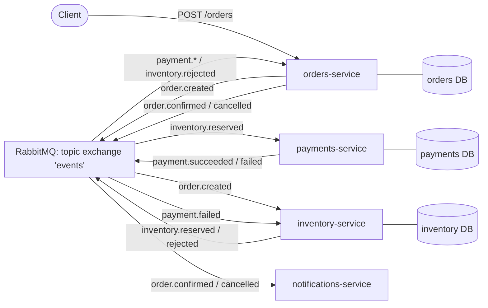

# Event-Driven Order Platform

A microservices order-processing backend in Python. Four services coordinate through
**RabbitMQ events** (the choreographed saga pattern). There are no direct service-to-service
calls, each service owns its own **PostgreSQL** database, and every part of the flow
is idempotent and covered by tests.



## How an order flows

| Step | Service | Consumes | Does | Publishes |
|---|---|---|---|---|
| 1 | orders | `POST /orders` | saves order as `PENDING` | `order.created` |
| 2 | inventory | `order.created` | checks stock and price; reserves stock | `inventory.reserved` or `inventory.rejected` |
| 3 | payments | `inventory.reserved` | charges the card (simulated limit) | `payment.succeeded` or `payment.failed` |
| 4 | inventory | `payment.failed` | **compensation:** releases the reserved stock | – |
| 5 | orders | `payment.*`, `inventory.rejected` | moves order to `CONFIRMED` / `CANCELLED` | `order.confirmed` / `order.cancelled` |
| 6 | notifications | `order.confirmed` / `order.cancelled` | notifies the customer | – |

## Engineering decisions

- **Choreography instead of a central orchestrator.** Services only know about events, not
  about each other, so a new consumer (for example analytics) can be added without changing
  any existing service.
- **Database per service.** Inventory is the only service that can change stock; other
  services find out about changes through events.
- **Idempotent consumers.** RabbitMQ delivers *at least once*, so the same message can arrive
  twice. Orders and inventory record every processed `event_id`, and payments enforces a unique
  `order_id`, so a redelivered message never double-reserves stock or double-charges a card.
  (Tested in [tests/test_saga.py](tests/test_saga.py).)
- **Retries and dead-letter queues.** A failing handler is retried 3 times. After that, the
  message is moved to `<service>.dlq` so it can be inspected instead of being lost or retried forever.
  (See [shared/common/messaging.py](shared/common/messaging.py).)
- **Server-side price check.** Inventory rejects any order whose prices don't match the catalog,
  so the client can't choose its own price.
- **Deadlock-safe locking.** Stock rows are locked with `SELECT ... FOR UPDATE` in sorted SKU order.
- **Testable core.** The business logic is plain functions (`event in, events out`), and the
  RabbitMQ code is a thin layer around them. That lets the full saga be tested end to end with
  an in-memory bus, with no Docker needed.
- **Structured JSON logs.** Every log line includes `service`, `event_type` and `order_id`,
  so one order can be traced across all four services.

## Run it

**Tests (no Docker needed):**
```powershell
python -m venv .venv
.\.venv\Scripts\pip install -r requirements-dev.txt
.\.venv\Scripts\pytest
.\.venv\Scripts\ruff check .
```

**Full stack (requires Docker Desktop):**
```powershell
docker compose up -d --build
python scripts/demo.py          # runs happy path, out-of-stock and declined-payment orders
docker compose logs -f orders   # follow the JSON logs
docker compose down -v
```

| Service | URL |
|---|---|
| orders API docs | http://localhost:8001/docs |
| inventory API docs | http://localhost:8002/docs |
| payments API docs | http://localhost:8003/docs |
| notifications | http://localhost:8004/notifications |
| RabbitMQ UI | http://localhost:15672 (guest / guest) |

## Project layout

```
shared/common/        event envelope, RabbitMQ publisher/consumer, logging, DB helpers
services/<name>/      one FastAPI service each: models, handlers (business logic), API, tests
services/Dockerfile   single parametrised image (--build-arg SERVICE=...), runs as non-root
tests/test_saga.py    end-to-end saga tests across all services
infra/                database bootstrap (Terraform + Kubernetes go here next)
```

## Roadmap

- [x] **Phase 1:** microservices, RabbitMQ saga, idempotency, DLQs, Docker Compose, 37 tests
- [x] **Phase 2:** GitHub Actions CI: lint → tests → full-stack integration run in Docker → images pushed to GHCR tagged by commit SHA ([ci.yml](.github/workflows/ci.yml))
- [ ] **Phase 3:** JWT auth, role-based access, secrets from AWS Secrets Manager
- [ ] **Phase 4:** Kubernetes manifests / Helm, deployed to `kind` locally and EKS with Terraform
- [ ] **Phase 5:** Prometheus metrics, Grafana dashboards, OpenTelemetry tracing
- [ ] **Known limitation → transactional outbox:** events are published *after* the DB commit, so a
      crash between those two steps can lose an event. The fix is to write events to an outbox table
      in the same transaction and have a relay publish them.
- [ ] Alembic migrations (tables are currently created on startup)
